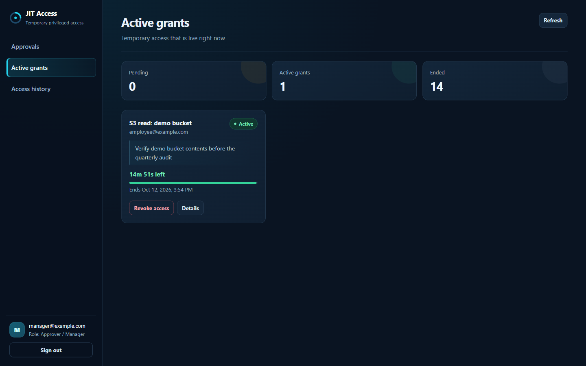
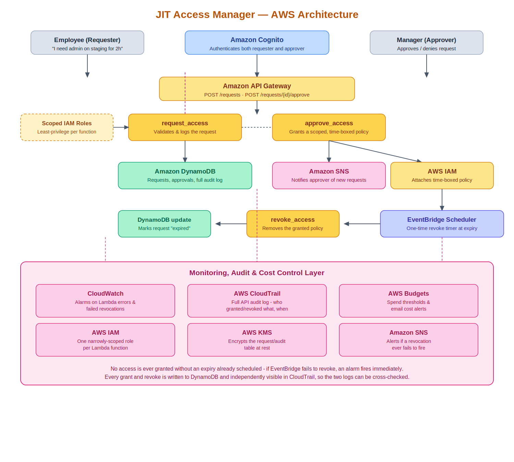
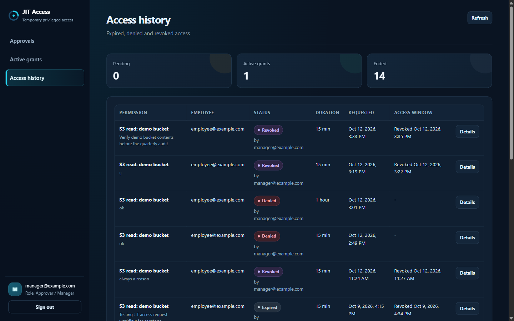
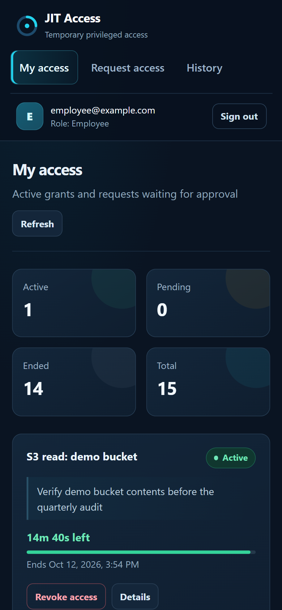

[](https://github.com/farisck/jit-access-cloud/actions/workflows/hello.yml)

[](https://codecov.io/github/farisck/jit-access-cloud)

# JIT Access Manager

A just-in-time privileged access platform on AWS — Cloud Computing capstone project.

An employee requests a specific, time-boxed elevated permission. A manager
approves or denies it. If approved, the permission is granted immediately
and **automatically revoked at the exact requested expiry**, with no manual
cleanup step anyone could forget. Every request, grant, and revocation is
logged in DynamoDB, and independently visible in the account's CloudTrail
history (see note below).

**Live demo:** https://jit.barfs.shop



> **Note on CloudTrail and Budgets:** this project doesn't deploy its own
> trail or budget. Both services operate at the AWS account level, not
> per-project, and this account already has a multi-region CloudTrail and
> a monthly Budget (originally set up for a separate project). Since they
> already capture every API call and every dollar spent account-wide, a
> second, JIT-specific trail and budget would be redundant. Confirmed by
> directly querying CloudTrail for this project's own `PutRolePolicy` and
> `DeleteRolePolicy` events — both show up correctly.

📄 Full proposal: [`docs/JIT_Access_Manager_Proposal.docx`](docs/JIT_Access_Manager_Proposal.docx)
🖥️ Frontend: [`frontend/index.html`](frontend/index.html) — a standalone dashboard, no build step required

## Why this design is safe to run in a real AWS account

Rather than accepting arbitrary IAM policy JSON from a requester (one typo
away from granting real admin), the system only ever grants from a small,
fixed **permission catalog** defined in the CloudFormation template:

- `s3-read-demo-bucket` — read-only access to one demo S3 bucket
- `dynamodb-read-requests` — read-only access to the requests table itself

Grants attach to a single, dedicated `TargetRole` that starts with **zero**
permissions. `approve_access` adds exactly one inline policy per grant;
`revoke_access` removes exactly that one policy. Nothing in this system can
ever touch any other role, user, or resource in the account.

## Architecture



```
Employee → Cognito → API Gateway → request_access → DynamoDB (pending) → SNS (notify approver)
Manager  → Cognito → API Gateway → approve_access  → IAM (grant) + EventBridge Scheduler (schedule revoke)
                                                    ↓ (at expiry, automatically)
                                        EventBridge Scheduler → revoke_access → IAM (revoke) → DynamoDB (expired)
                                                                              ↓
                                          CloudWatch alarm on failed revocations · account-wide CloudTrail
```

Frontend delivery:

```
Browser → https://jit.barfs.shop → CloudFront (ACM certificate) → private S3 bucket (index.html)
Browser → API Gateway (Cognito-authenticated calls)
```

Both the employee and manager use the same dashboard (`frontend/index.html`)
instead of calling the API directly — see **Frontend** below.

## Status

| Phase | What it builds | Status |
|---|---|---|
| 1 — Foundation | Cognito (+ approvers group), requests table, demo bucket, target IAM role, SNS | ✅ Deployed |
| 2 — Compute | 4 Lambdas, HTTP API, Cognito authorizer, EventBridge Scheduler wiring | ✅ Deployed and tested end-to-end |
| 3 — Monitoring | CloudWatch alarm on failed revocations | ✅ Deployed and tested |
| 3 — Monitoring (cont.) | CloudTrail, AWS Budgets | ✅ Covered by an existing account-wide trail and budget (see note above) |
| Frontend | Employee/manager dashboard (dark navy/cyan redesign) | ✅ Built, tested, and live |
| Hosting | Private S3 bucket + CloudFront + ACM certificate + custom domain | ✅ Live at https://jit.barfs.shop |

## Repo layout

```
jit-access-cloud/
├── infra/cloudformation/
│   ├── 01-foundation.yaml    # Cognito, DynamoDB, demo bucket, target role, SNS
│   ├── 02-compute-api.yaml   # 4 Lambdas + HTTP API + Cognito authorizer + Scheduler
│   └── 03-monitoring.yaml    # CloudWatch alarm on failed revocations
├── lambda/
│   ├── request_access/       # POST /requests
│   ├── approve_access/       # POST /requests/{id}/approve — the core grant logic
│   ├── revoke_access/        # DELETE /requests/{id} (manual) + EventBridge target (automatic)
│   └── list_requests/        # GET /requests[?status=pending]
├── frontend/
│   ├── index.html            # Standalone employee/manager dashboard (no build step)
│   ├── favicon.ico
│   └── favicon.svg
├── tests/                    # Python unit tests
├── docs/
│   ├── JIT_Access_Manager_Proposal.docx
│   ├── DEMO.md               # Full step-by-step demo walkthrough
│   ├── architecture.png
│   └── screenshots/          # Dashboard screenshots used in this README
```

## Prerequisites

- AWS CLI v2, configured (`aws configure`)
- Region: `us-east-1` (used throughout the commands below)

## Deploying the backend

```bash
# Phase 1 — Foundation
aws cloudformation deploy \
  --template-file infra/cloudformation/01-foundation.yaml \
  --stack-name jit-access-dev-foundation \
  --capabilities CAPABILITY_NAMED_IAM \
  --region us-east-1

# One-time: create a bucket to hold packaged Lambda artifacts
ACCOUNT_ID=$(aws sts get-caller-identity --query Account --output text)
aws s3 mb "s3://jit-access-dev-lambda-artifacts-${ACCOUNT_ID}" --region us-east-1

# Phase 2 — Compute: package (zips each Lambda folder, uploads to S3),
# then deploy the PACKAGED template (not the original)
aws cloudformation package \
  --template-file infra/cloudformation/02-compute-api.yaml \
  --s3-bucket "jit-access-dev-lambda-artifacts-${ACCOUNT_ID}" \
  --output-template-file infra/cloudformation/02-compute-api.packaged.yaml

aws cloudformation deploy \
  --template-file infra/cloudformation/02-compute-api.packaged.yaml \
  --stack-name jit-access-dev-compute \
  --capabilities CAPABILITY_NAMED_IAM \
  --region us-east-1

# Get the API endpoint
aws cloudformation describe-stacks --stack-name jit-access-dev-compute \
  --query "Stacks[0].Outputs" --region us-east-1

# Phase 3 — Monitoring (CloudWatch alarm on failed revocations)
aws cloudformation deploy \
  --template-file infra/cloudformation/03-monitoring.yaml \
  --stack-name jit-access-dev-monitoring \
  --capabilities CAPABILITY_NAMED_IAM \
  --region us-east-1
```

## Setting up a demo requester and approver

```bash
POOL_ID=$(aws cloudformation describe-stacks --stack-name jit-access-dev-foundation \
  --query "Stacks[0].Outputs[?OutputKey=='UserPoolId'].OutputValue" --output text --region us-east-1)
CLIENT_ID=$(aws cloudformation describe-stacks --stack-name jit-access-dev-foundation \
  --query "Stacks[0].Outputs[?OutputKey=='UserPoolClientId'].OutputValue" --output text --region us-east-1)

# Requester
aws cognito-idp admin-create-user --user-pool-id $POOL_ID --username employee@example.com \
  --temporary-password '<temporary-password>' --message-action SUPPRESS --region us-east-1
aws cognito-idp admin-set-user-password --user-pool-id $POOL_ID --username employee@example.com \
  --password '<your-password>' --permanent --region us-east-1

# Approver — same steps, then add to the approvers group
aws cognito-idp admin-create-user --user-pool-id $POOL_ID --username manager@example.com \
  --temporary-password '<temporary-password>' --message-action SUPPRESS --region us-east-1
aws cognito-idp admin-set-user-password --user-pool-id $POOL_ID --username manager@example.com \
  --password '<your-password>' --permanent --region us-east-1
aws cognito-idp admin-add-user-to-group --user-pool-id $POOL_ID --username manager@example.com \
  --group-name approvers --region us-east-1
```

## Frontend

The dashboard is a single file, `frontend/index.html`, with no build step or
npm install. It uses a dark navy and cyan theme and a responsive layout that
also works on phone-sized screens.

What each user sees:

- **Employee** — **My access**: a request form, active grants with a live countdown, and request history
- **Manager** (must be in the `approvers` Cognito group) — **Approvals** (pending queue with approve/deny), **Active grants** (with a revoke action), and **Access history** (expired, denied and revoked requests)

| Manager: active grants | Manager: access history |
|---|---|
|  |  |

| Employee: mobile view |
|---|
|  |

### Local testing

From the repo root, serve the `frontend` folder with Python:

```powershell
# Windows (using the project's virtual environment)
.\.venv\Scripts\python.exe -m http.server 5500 -d frontend

# macOS / Linux
python3 -m http.server 5500 -d frontend
```

Then open `http://localhost:5500`.

## Deploying the frontend (S3 + CloudFront)

The frontend is hosted in a **private** S3 bucket (no public access) and
served through CloudFront over HTTPS at **https://jit.barfs.shop**. An ACM
certificate in `us-east-1` provides TLS for the custom domain, and a CNAME
record at the DNS provider (GoDaddy) points `jit` at the CloudFront domain.

> Pushing to GitHub does **not** update the live site. The frontend is
> uploaded to S3 manually (below). No automated deployment workflow is
> configured.

Replace the placeholders with your own values:

```powershell
# 1. Confirm you are in the right AWS account
aws sts get-caller-identity

# 2. Upload the page (no-cache so updates show up quickly)
aws s3 cp frontend\index.html s3://<frontend-bucket>/index.html `
  --content-type "text/html" --cache-control "no-cache" --region us-east-1

# 3. Upload the favicon
aws s3 cp frontend\favicon.ico s3://<frontend-bucket>/favicon.ico `
  --content-type "image/vnd.microsoft.icon" --cache-control "public, max-age=86400" --region us-east-1

# 4. Clear CloudFront's cached copies
aws cloudfront create-invalidation --distribution-id <distribution-id> --paths "/index.html" "/favicon.ico"

# 5. Check the invalidation status (wait for "Completed")
aws cloudfront list-invalidations --distribution-id <distribution-id> --max-items 3
```

Verify the deployment:

```powershell
curl.exe -I https://jit.barfs.shop/favicon.ico        # expect HTTP 200
curl.exe -s https://jit.barfs.shop/index.html | Measure-Object -Character   # should match the new file's size
```

**DNS troubleshooting tip:** if the custom domain doesn't resolve, compare the
CNAME value at the DNS provider character by character with the CloudFront
domain shown in the console. A single swapped letter produces a hostname that
doesn't exist, and resolvers cache that failure for a while, so a fix can take
up to an hour to show up on some networks.

## Testing and CI

Backend logic is covered by Python unit tests in `tests/`, run automatically
by GitHub Actions on every push. Coverage is reported to Codecov (badge at
the top). At the last check, 42 unit tests passed with about 95.8% coverage
against a 90% threshold.

Run the tests locally from the repo root:

```bash
pytest tests/
```

Manual end-to-end checks on the live site (employee and manager accounts):

| Check | Expected result |
|---|---|
| Employee submits a request | Appears as **Pending** for the manager |
| Manager approves | Status becomes **Active**, with a countdown |
| Manager denies | Status becomes **Denied**, no IAM grant created |
| Manager revokes an active grant | Status becomes **Revoked** and the grant leaves Active grants |
| Duration passes | Status becomes **Expired** automatically |
| `aws iam list-role-policies --role-name jit-access-dev-target-role` after revoke/expiry | `"PolicyNames": []` |
| Browser console (F12) | No errors |

## Demo flow

For the full 9-step walkthrough (including IAM verification commands and
the automatic-expiry check), see [`docs/DEMO.md`](docs/DEMO.md). Quick
version:

1. Sign in as the employee at https://jit.barfs.shop and submit a request (for example, 15 minutes, with a realistic reason)
2. Sign in as the manager and approve it; confirm it shows under **Active grants**
3. Confirm the grant is real: `aws iam list-role-policies --role-name jit-access-dev-target-role` shows one policy
4. Either click **Revoke access**, or wait for the duration to pass
5. Run the same IAM command again — `"PolicyNames": []`, with no manual cleanup
6. Check **Access history** and DynamoDB — the request moved `pending` → `active` → `revoked` or `expired`, each with a timestamp
7. Submit one more request and **deny** it as the manager to show the denied path

## Tearing down

```bash
aws cloudformation delete-stack --stack-name jit-access-dev-monitoring --region us-east-1
aws cloudformation wait stack-delete-complete --stack-name jit-access-dev-monitoring --region us-east-1

aws cloudformation delete-stack --stack-name jit-access-dev-compute --region us-east-1
aws cloudformation wait stack-delete-complete --stack-name jit-access-dev-compute --region us-east-1

aws cloudformation delete-stack --stack-name jit-access-dev-foundation --region us-east-1
```

Resources not managed by these stacks must be removed manually:

- Lambda artifacts bucket: `aws s3 rb s3://jit-access-dev-lambda-artifacts-<account-id> --force`
- Frontend: the S3 bucket, the CloudFront distribution (disable, then delete), the ACM certificate, and the `jit` CNAME record at the DNS provider

## Cost notes

Designed to run inside AWS Free Tier — everything here (Lambda, DynamoDB,
API Gateway, EventBridge Scheduler, SNS, Cognito, CloudWatch) has a generous
always-free or 12-month-free allowance. The public frontend uses S3 and
CloudFront, which are low-cost at demo traffic, and ACM public certificates
are free. No NAT Gateway or customer-managed KMS key is used — the DynamoDB
table uses its default AWS-owned encryption key, which carries no additional
charge.
